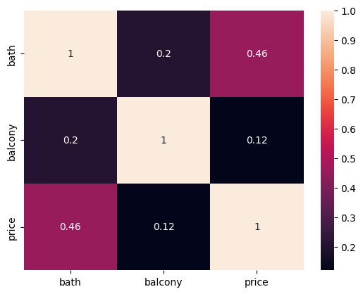
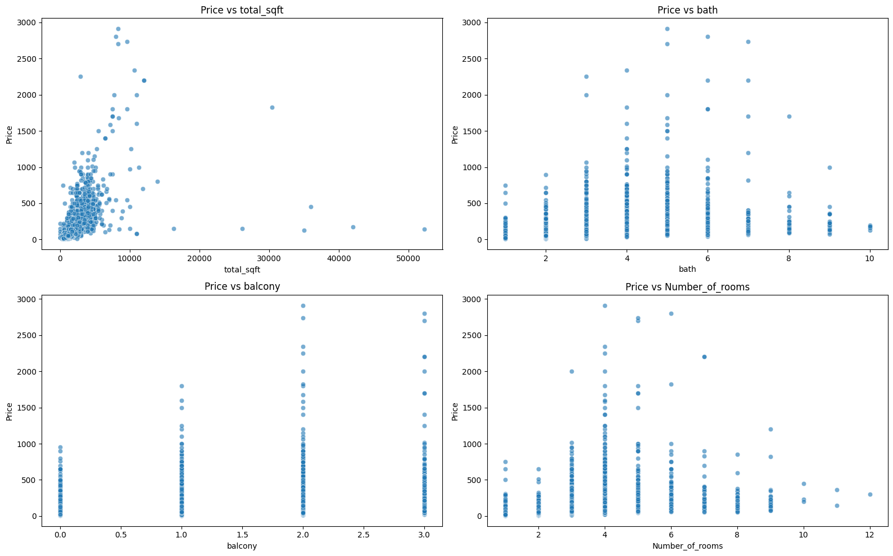
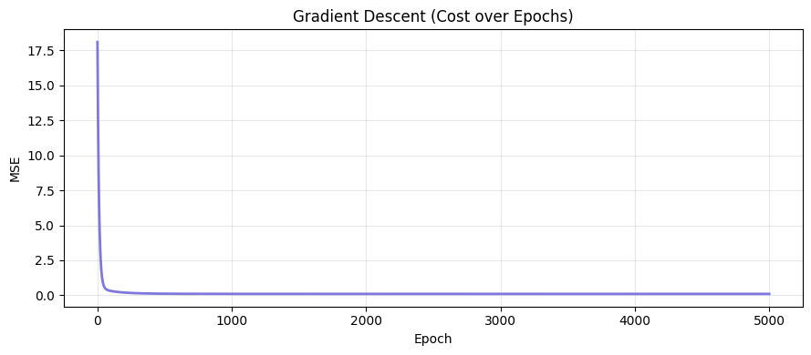
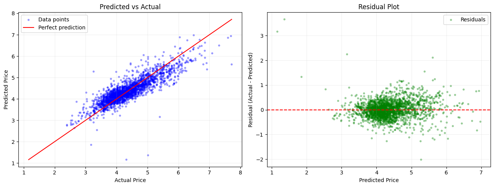
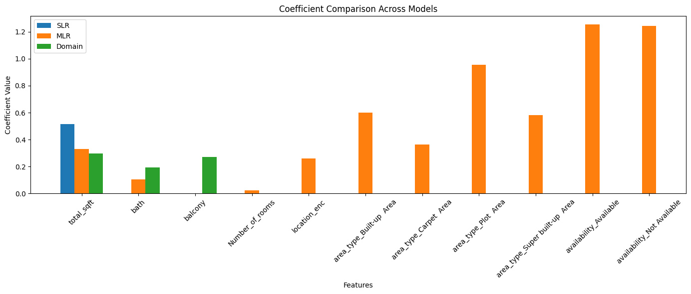

# Bengaluru House Price Prediction: Regression From Scratch

An end-to-end regression project on the real-world, messy Bengaluru House Price dataset (13,320 listings). Every model is implemented **from scratch using NumPy only**: Simple Linear Regression (Numerical and Statistical views) and Multiple Linear Regression via Gradient Descent, each with optional **Ridge (L2)** and **Lasso (L1)** regularization. Twelve model variants are compared using R² and Adjusted R².

## Demo

*Exploratory Data Analysis - Correlation Heatmap*


*Price vs. Key Features*


*Gradient Descent Convergence (Cost over Epochs)*


*Best Model: Predicted vs. Actual and Residuals*


*Coefficient Comparison Across Models*


## Features

- **Real-World Data Cleaning:** Handles duplicates, missing values, inconsistent formats (`2 BHK` vs `4 Bedroom`, ranges like `1133 - 1384` in square footage), and unrealistic outliers.
- **In-Depth EDA:** Price distribution, correlation heatmap, box plots with IQR bounds, and feature-vs-price scatter plots, with static and interactive (Plotly) versions.
- **Skew Correction:** Applies `log1p` to `price` and `total_sqft` to normalize right-skewed distributions and improve gradient descent convergence.
- **Leakage-Safe Preprocessing:** Target encoding for the high-cardinality `location` feature, one-hot encoding for low-cardinality features, and standardization, all fitted on the training set only.
- **Three Regression Approaches From Scratch:**
  - Simple Linear Regression, **Numerical View** (OLS via the normal equations)
  - Simple Linear Regression, **Statistical View** (closed-form `SXY / SXX` derivation)
  - Multiple Linear Regression via **Gradient Descent**
- **Regularization Built In:** Each model class accepts `regularization='ridge'` or `'lasso'` and a `lambda_` strength, with no penalty by default.
- **Domain Knowledge Model:** A reduced three-feature model (`total_sqft`, `bath`, `location_enc`) chosen from EDA, compared against the full-feature model.
- **Thorough Evaluation:** R², Adjusted R², and MSE on both the log scale and the original price scale, plus residual and predicted-vs-actual diagnostics for every variant.

## Tech Stack

- **Language:** Python 3.11+
- **Libraries:**
  - `numpy`: All model implementations (gradient descent, normal equations, regularization)
  - `pandas`: Data loading, cleaning, and manipulation
  - `matplotlib`: Static diagnostic plots
  - `seaborn`: Statistical data visualization
  - `plotly`: Interactive plots (histograms, box plots, scatter plots, residuals)
  - `statsmodels`: Required by Plotly for the OLS trendlines
  - `scikit-learn`: Used **only** for `train_test_split`, `OneHotEncoder`, and `StandardScaler`
- **Algorithms:** Simple Linear Regression (OLS), Multiple Linear Regression (Gradient Descent), Ridge (L2), Lasso (L1)
- **Data Source:** [Bengaluru House Price dataset (Kaggle)](https://www.kaggle.com/datasets/amitabhajoy/bengaluru-house-price-data)

## Dataset

| Column | Description |
|---|---|
| `area_type` | Type of area (Super built-up, Built-up, Plot, Carpet) |
| `availability` | Possession date or `Ready To Move` |
| `location` | Neighborhood (1,305 unique values) |
| `size` | Size as text, e.g. `2 BHK`, `4 Bedroom` |
| `society` | Housing society name (41% missing, dropped) |
| `total_sqft` | Area in square feet (contains ranges and non-numeric entries) |
| `bath` | Number of bathrooms |
| `balcony` | Number of balconies |
| `price` | **Target:** price in lakhs (INR) |

## Methodology

1. **Data Quality Audit:** 13,320 rows, 529 duplicates, and missing values in `society`, `balcony`, `bath`, `size`, and `location`.
2. **Cleaning:**
   - Removed duplicates.
   - Extracted a numeric `Number_of_rooms` from `size`.
   - Converted `total_sqft` ranges to their average.
   - Simplified `availability` into `Available` / `Not Available`.
   - Dropped `society` (41.3% missing) and rows with other missing values.
   - Removed unrealistic listings with more than 10 bathrooms. High prices were kept, since they plausibly represent luxury properties.
3. **Transformation:** `log1p` on `price` and `total_sqft`.
4. **Split:** 80/20 train-test split (9,709 train / 2,428 test, `random_state=42`).
5. **Encoding and Scaling:**
   - Target-encoded `location` using the training-set mean log price. Unseen locations fall back to the global training mean.
   - One-hot encoded `area_type` and `availability`.
   - Standardized the numeric features, fitted on the training data only.
6. **Modeling:** Trained all 12 variants (see below) and compared them.

## Results

| Model | Type | Regularization | # Predictors | R² | Adjusted R² |
|---|---|---|---|---|---|
| **Gradient Descent Plain** | MLR | None | 11 | **0.7493** | **0.7490** |
| Gradient Descent Ridge | MLR | L2 | 11 | 0.7483 | 0.7480 |
| Gradient Descent Lasso | MLR | L1 | 11 | 0.7464 | 0.7461 |
| Domain Knowledge Plain | MLR | None | 3 | 0.7067 | 0.7066 |
| Domain Knowledge Ridge | MLR | L2 | 3 | 0.7065 | 0.7064 |
| Domain Knowledge Lasso | MLR | L1 | 3 | 0.7062 | 0.7061 |
| Numerical View Plain | SLR | None | 1 | 0.5270 | 0.5270 |
| Numerical View Ridge | SLR | L2 | 1 | 0.5259 | 0.5258 |
| Numerical View Lasso | SLR | L1 | 1 | 0.5222 | 0.5221 |
| Statistical View Plain | SLR | None | 1 | 0.5270 | 0.5270 |
| Statistical View Ridge | SLR | L2 | 1 | 0.5259 | 0.5258 |
| Statistical View Lasso | SLR | L1 | 1 | 0.5222 | 0.5221 |

### Key Findings

- **`total_sqft` is the strongest single predictor** (correlation of 0.745 with log price), followed by `location_enc` (0.668) and `bath` (0.647).
- **Multiple features beat a single one:** moving from one predictor (R² ≈ 0.53) to the full feature set (R² ≈ 0.75) gives a large improvement.
- **The three-feature domain model is a strong trade-off:** it reaches R² ≈ 0.71 with only `total_sqft`, `bath`, and `location_enc`, losing about 0.04 R² against the full model while being much simpler to interpret.
- **The Numerical and Statistical views agree exactly,** as expected, since they are two derivations of the same OLS solution (and the same Ridge/Lasso solutions).
- **Regularization had a negligible effect.** Plain models scored marginally higher than Ridge and Lasso, which suggests little overfitting with this small number of well-behaved features.
- **Test MSE on the original price scale (lakhs²):** Gradient Descent Plain ≈ 6,958, Domain Knowledge Plain ≈ 8,377, Simple Linear Regression ≈ 9,859.

## Getting Started

### Prerequisites
- Python 3.11 or higher
- Jupyter Notebook or JupyterLab
- The dataset file `Bengaluru_House_Data.csv` in the project root

### Installation

Clone the repository:
```bash
git clone https://github.com/YourUsername/bengaluru-house-price-regression.git
cd bengaluru-house-price-regression
```

Install the dependencies:
```bash
pip install numpy pandas matplotlib seaborn plotly statsmodels scikit-learn jupyter
```

### Usage

Launch Jupyter and run the notebook from top to bottom:
```bash
jupyter notebook bengaluru_house_price_regression.ipynb
```

Each model class can also be used on its own:
```python
model = MultipleLinearRegressionGD(regularization='ridge', lambda_=0.01)
model.fit(x_train, y_train, learning_rate=0.01, epochs=5000)

y_pred = model.predict(x_test)
print(model.r2_score(y_test, y_pred))
model.plot_cost()  # gradient descent convergence curve
```

## Limitations and Future Work

- Add k-fold cross-validation and tune the regularization strength (`lambda_`) instead of using fixed values.
- Evaluate non-linear models (e.g. Random Forest, Gradient Boosting) against the from-scratch linear baselines.
- Use a more robust location encoding (e.g. smoothed or cross-validated target encoding) to handle rare locations.
- Add outlier handling for price per square foot to catch inconsistent listings.
